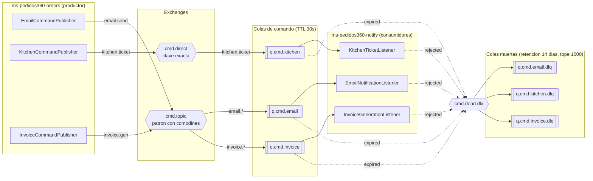

# Mensajeria de Pedidos360

## Productores, exchanges, colas y consumidores



Son **seis colas**: tres de comando y su respaldo correspondiente.

## Los dos caminos hacia la cola muerta

Un mensaje llega a la DLQ por dos motivos distintos, y el broker los registra
en el header `x-death` del propio mensaje:

| Motivo | Cuando ocurre | Quien lo decide |
|---|---|---|
| `rejected` | El consumidor esta arriba y rechaza el mensaje porque viene mal formado | El codigo, con un NACK sin requeue |
| `expired` | Nadie lo consumio dentro del TTL de la cola, por ejemplo porque el consumidor esta caido | El broker, solo |

Los dos se pueden demostrar en vivo, y es la diferencia entre "el mensaje
estaba malo" y "el servicio que tenia que atenderlo no estaba".

## Politicas de retencion y limpieza

Configuradas en el bloque `mensajeria.retencion` del `application.yml`:

| Politica | Valor | Para que |
|---|---|---|
| `x-message-ttl` en colas de comando | 30 s | Un comando sin consumir vence y cae a la DLQ en vez de quedarse encolado para siempre |
| `x-message-ttl` en las DLQ | 14 dias | Cuanto se conserva la evidencia para revisarla a mano |
| `x-max-length` en las DLQ | 1000 | Una tormenta de errores no llena el disco del nodo |

Los 30 segundos son deliberadamente cortos para poder demostrar la caida de un
consumidor en vivo. Un despliegue real usaria minutos u horas, segun cuanto
tolere el negocio que un comando llegue tarde.

## Reproducir los dos escenarios

Con el entorno local levantado (`docker compose -f infra/local/docker-compose.yml up -d`)
y `ms-orders` y `ms-notify` corriendo con el perfil `dev`.

### Camino feliz

Crear un pedido desde el frontend. Esa sola accion publica los tres comandos, y
el log de `ms-notify` muestra los tres consumidores trabajando y confirmando:

```
INFO  EmailNotificationListener : Enviando email al cliente ... (correlationId=...)
INFO  ConfirmacionDeMensajes    : [email] Evento ... confirmado (ACK)
INFO  KitchenTicketListener     : Ticket de cocina para el pedido ... (correlationId=...)
INFO  ConfirmacionDeMensajes    : [kitchen] Evento ... confirmado (ACK)
INFO  InvoiceGenerationListener : Documento de cobro del pedido ... (correlationId=...)
INFO  ConfirmacionDeMensajes    : [invoice] Evento ... confirmado (ACK)
```

El mismo `correlationId` recorre los tres, asi que una operacion se sigue de
punta a punta.

### Consumidor caido

```bash
# 1. Bajar el consumidor
pkill -f ms-pedidos360-notify

# 2. Publicar un comando perfectamente valido
curl -u guest:guest -X POST "http://localhost:15672/api/exchanges/%2F/cmd.direct/publish" \
  -H "content-type: application/json" \
  -d '{"properties":{"content_type":"application/json"},
       "routing_key":"kitchen.ticket",
       "payload":"{\"type\":\"KitchenTicketRequested\",\"eventId\":\"k-1\",\"payload\":{\"orderId\":77,\"customerId\":\"c\",\"cantidadItems\":4}}",
       "payload_encoding":"string"}'

# 3. En la consola, q.cmd.kitchen tiene 1 mensaje y 0 consumidores.
#    A los 30 segundos pasa solo a q.cmd.kitchen.dlq.

# 4. Leer el motivo que puso el broker
curl -u guest:guest -X POST "http://localhost:15672/api/queues/%2F/q.cmd.kitchen.dlq/get" \
  -H "content-type: application/json" \
  -d '{"count":1,"ackmode":"ack_requeue_true","encoding":"auto"}'
```

En el header `x-death` del mensaje aparece `"reason":"expired"` y
`"queue":"q.cmd.kitchen"`.

## Monitoreo del clúster

La consola de RabbitMQ (`http://localhost:15672`, o por tunel SSH en la nube)
es la fuente de metricas del cluster:

- **Overview → Nodes**: los dos nodos, su memoria, disco y descriptores
- **Queues**: profundidad de cada cola, tasa de entrada y salida, consumidores
  enganchados. Es donde se ve en vivo que una cola se llena cuando su consumidor
  se cae
- **Queues → q.cmd.\*.dlq**: el contenido de las colas muertas y, en cada
  mensaje, el header `x-death` con el motivo

Los logs de los contenedores pueden ademas enviarse a **CloudWatch Logs** en el
despliegue de AWS, con el override `infra/apps/docker-compose.cloudwatch.yml`.
